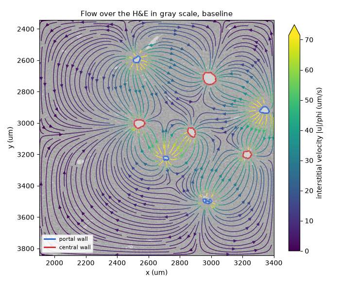

# slidesim

slidesim simulates spatial PDE-ODE systems on real tissue geometry. The geometry and the local
parameters come from whole-slide scans and spatial transcriptomics, preprocessed by
[slideviz](https://github.com/matthiaskoenig/slideviz). On this geometry, PDEs describe transport
(diffusion, perfusion along the sinusoids, advection), and every mesh element carries an SBML ODE
network which supplies local sources and sinks. slidesim is written in Rust on
[PETSc](https://petsc.org) and [libCEED](https://libceed.org), runs on one process or many with
MPI, and writes its results for ParaView.

The Darcy flow through a 1500 um field of a mouse liver slide, from the portal walls to the
central walls, over the H&E of the field ([milestone 2 results](results/2026-11-m2-real-slide.md)).

## The pipeline

A slide passes three programs, joined by two contracts which slidesim defines
([Contracts](contracts.md)):

<svg class="sim-diagram" viewBox="0 12 684 300" xmlns="http://www.w3.org/2000/svg" role="img"
     aria-label="slideviz turns whole-slide images into a scene/1: the mesh and the maps. sbmlsim-core translates an SBML model into C code for the cells. slidesim reads the scene, the study/1 and the model code, solves the Darcy perfusion, the transport of the fields and the cell models on the elements, coupled by Strang splitting, and writes VTU files and summary.json.">
  <defs>
    <marker id="sd-arrow" viewBox="0 0 10 10" refX="9" refY="5" markerWidth="6" markerHeight="6" orient="auto-start-reverse">
      <path d="M 0 0 L 10 5 L 0 10 z" fill="currentColor"/>
    </marker>
    <marker id="sd-arrow-accent" viewBox="0 0 10 10" refX="9" refY="5" markerWidth="6" markerHeight="6" orient="auto-start-reverse">
      <path d="M 0 0 L 10 5 L 0 10 z" fill="var(--sd-accent)"/>
    </marker>
  </defs>
  <!-- the programs before slidesim -->
  <g>
    <rect x="8" y="36" width="150" height="48" rx="6"/>
    <text x="83" y="57">slideviz</text>
    <text class="sd-sub" x="83" y="73">slides to mesh and maps</text>
    <rect x="8" y="236" width="150" height="48" rx="6"/>
    <text x="83" y="257">sbmlsim-core</text>
    <text class="sd-sub" x="83" y="273">SBML model to C code</text>
  </g>
  <line x1="164" y1="60" x2="188" y2="60" marker-end="url(#sd-arrow)"/>
  <line x1="164" y1="260" x2="188" y2="260" marker-end="url(#sd-arrow)"/>
  <!-- the inputs of a run -->
  <g class="sd-artifact">
    <rect x="194" y="36" width="130" height="48" rx="4"/>
    <rect x="194" y="136" width="130" height="48" rx="4"/>
    <rect x="194" y="236" width="130" height="48" rx="4"/>
  </g>
  <text class="sd-contract" x="259" y="57">scene/1</text>
  <text class="sd-sub" x="259" y="73">mesh, maps</text>
  <text class="sd-contract" x="259" y="157">study/1</text>
  <text class="sd-sub" x="259" y="173">fields, flow, cells</text>
  <text x="259" y="257">model code</text>
  <text class="sd-sub" x="259" y="273">C, QFunction</text>
  <line x1="330" y1="60" x2="354" y2="60" marker-end="url(#sd-arrow)"/>
  <line x1="330" y1="160" x2="354" y2="160" marker-end="url(#sd-arrow)"/>
  <line x1="330" y1="260" x2="354" y2="260" marker-end="url(#sd-arrow)"/>
  <!-- slidesim -->
  <g class="sd-instance">
    <rect x="360" y="20" width="176" height="284" rx="10"/>
  </g>
  <text class="sd-title" x="448" y="40">slidesim run</text>
  <g class="sd-module">
    <rect x="374" y="52" width="148" height="50" rx="6"/>
    <rect x="374" y="136" width="148" height="50" rx="6"/>
    <rect x="374" y="230" width="148" height="50" rx="6"/>
  </g>
  <text x="448" y="74">perfusion</text>
  <text class="sd-sub" x="448" y="90">Darcy, conservative flux</text>
  <text x="448" y="158">transport</text>
  <text class="sd-sub" x="448" y="174">SUPG, BDF2, multigrid</text>
  <text x="448" y="252">cells</text>
  <text class="sd-sub" x="448" y="268">one model per element</text>
  <line class="sd-call" x1="448" y1="106" x2="448" y2="130" marker-end="url(#sd-arrow-accent)"/>
  <text class="sd-label" x="456" y="122">velocity</text>
  <line class="sd-call" x1="448" y1="192" x2="448" y2="224" marker-start="url(#sd-arrow-accent)" marker-end="url(#sd-arrow-accent)"/>
  <text class="sd-label" x="456" y="212">exchange</text>
  <!-- outputs -->
  <line x1="542" y1="136" x2="566" y2="136" marker-end="url(#sd-arrow)"/>
  <line x1="542" y1="206" x2="566" y2="206" marker-end="url(#sd-arrow)"/>
  <g class="sd-artifact">
    <rect x="572" y="112" width="104" height="48" rx="4"/>
    <rect x="572" y="182" width="104" height="48" rx="4"/>
  </g>
  <text x="624" y="133">VTU files</text>
  <text class="sd-sub" x="624" y="149">for ParaView</text>
  <text x="624" y="203">summary.json</text>
  <text class="sd-sub" x="624" y="219">balances, phases</text>
</svg>

- **slideviz** reads the slides, does the image analysis (tissue, lumina, zonation, necrosis),
  builds a 2D gmsh triangle mesh of a field with tagged walls (`portal_wall`, `central_wall`,
  `vessel_wall`, ...) and writes the `scene/1`: the mesh and raster **maps** over the tissue
  (`zonation`, `cyp2e1`, `necrosis`) as Zarr v3.
- **sbmlsim-core** translates the SBML model of one cell into C: point functions for its
  engine (CVODE, IDA), and a libCEED QFunction with a Rosenbrock integrator for the batched path.
- **slidesim** reads the scene and the `study/1`, which names the fields, their coefficients
  (numbers or tables over maps), the perfusion, the cell model and the times. It reads the gmsh mesh
  of the scene, or meshes tagged polygons or ideal lobules itself ([Meshing](methods/meshing.md)).
  It solves the steady Darcy flow, then steps the fields and the cells, coupled by Strang splitting,
  and writes the fields, the pressure, the velocity and the cell states as VTU, the fields and the
  cell states with the mesh as the Zarr store `result/1` for viewers, and a `summary.json` with the
  flows, the mass balance and the time per phase.

Nothing in slidesim is specific to an organ or a model: maps, tags, fields and models are data
of the contracts. "Portal", "central" and "zonation" appear only as names in the scenes and
studies of the liver.

## Milestones

| Milestone | What it brought | Results |
| --- | --- | --- |
| 0 | Spike: PETSc and libCEED driven from Rust in `wasm32-wasip1`, a 2D Poisson problem in wasmtime and Node, within 3.3e-16 of the native run | |
| 1 | Diffusion-reaction on slideviz meshes, P1 on DMPlex, libCEED operators, BDF2, geometric multigrid, MPI | |
| 2 | Maps in the scene, coefficients as tables over maps, anisotropic Darcy perfusion, advection with SUPG, mass balance | [Perfusion on a real slide](results/2026-11-m2-real-slide.md) |
| 3 | Conservative Darcy velocity, SBML cell models on every element (engine and batched libCEED paths), Strang coupling, performance | [Wall classes](results/2026-11-m3-wall-classes.md), [performance](results/2026-11-m3-performance.md) |

Later milestones bring the `result/1` output and a web viewer, the browser build, GPUs (libCEED's
CUDA and HIP backends) and 3D meshes from stacks of serial sections; the cell models on the dosed
slides, calibrated to their necrosis, wait for larger hardware
([deferred](results/m3-dosed-slides.md)).

## Where to go next

- [Installation](installation.md): the native dependencies and the build.
- [Running a study](usage.md): the command line, the outputs and `summary.json`.
- [Methods](methods/index.md): the numerics of transport, perfusion and the cell models.
- [Results](results/index.md): the milestone runs on real slides, with their numbers and figures.
