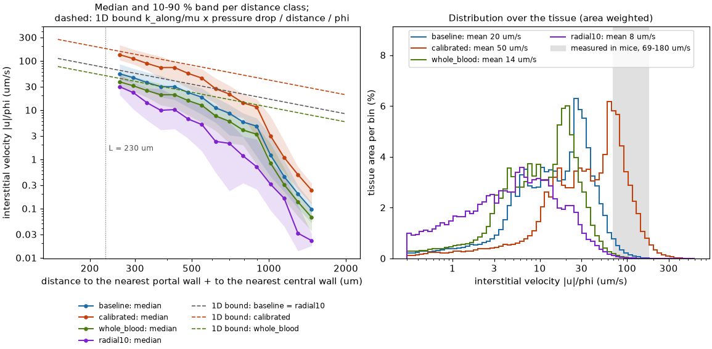
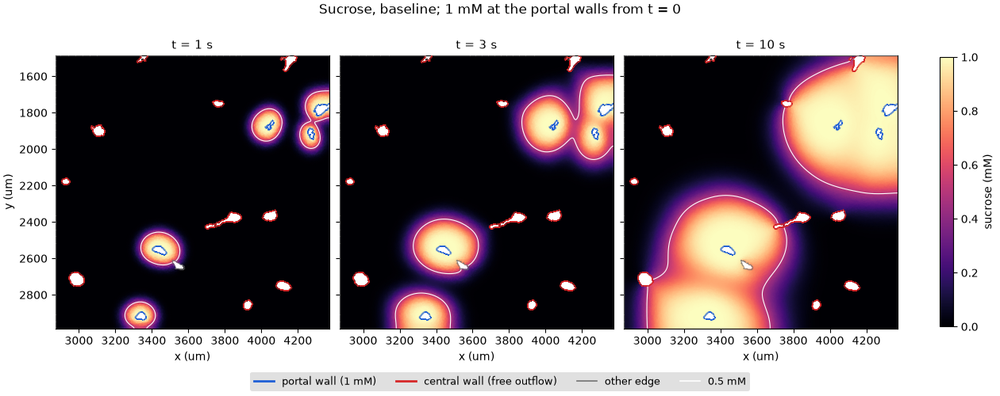
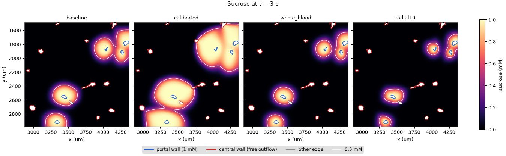

# Milestone 2 end to end on a real slide

Status: 2026-11-25, slidesim branch `feat/m2-perfusion`, slideviz branch `feat/scene-export`
(7ddd651); the run outputs of this document come from `scripts/e2e/m2_real_slide.sh` on that state.
Verification item 6 of `docs/superpowers/specs/2026-11-25-slidesim-m2-perfusion-design.md`, with
the parameters of `docs/parameters/m2-perfusion-mouse.md`. Not part of CI: the slides are not in
the repository.

## Summary

- The chain from a slide pair to slidesim runs without manual steps
  (`scripts/e2e/m2_real_slide.sh`, about 30 s for the slideviz part, 7-8 min per study on 4
  processes).
- The flow checks hold in every run: portal walls inflow, central walls outflow, net flow below
  3e-13 of the wall flow; and per wall piece (spec item 6): each of the 5 portal wall pieces has
  net inflow and each of the 13 central wall pieces net outflow, in all four studies.
- The field is the 1500 um window of the slide with the most tagged vessels (5 portal, 13 central
  wall pieces). Its mean interstitial velocity is 20 um/s for the baseline, a quarter of the 73
  um/s the parameter document expects; calibrated 50 um/s instead of 180 um/s. The velocities
  scale with k/mu exactly; the difference is the geometry: the median distance from a point to
  the nearest portal wall plus the nearest central wall is 548 um, not 230 um. Where portal and
  central walls are as close as in the parameter document, the model gives 52-57 um/s (baseline)
  and 126-140 um/s (calibrated).
- The missing walls are mainly a lumen detection gap: the slide has 221 CYP2E1 lobules but only
  113 open lumina of at least 500 um^2, of which 48 are classified portal or central.
- `advection_defect`, the non-conservation of the primal P1 Darcy velocity, is 8.7 % of the portal
  inflow at 1 s and 5.7 % at 10 s with 2 refinements, 13.7 % and 9.1 % with 1, 21.2 % and 14.2 %
  with none; on the first field it was 4.6 % at 1 s with 3 refinements. It falls with the element
  size at an order of about 0.65. The total mass hardly shows it: it agrees between the levels
  within 0.7 %, and its rate of change at 1 s does not depend on the level (0.1 %). The split of
  the mass balance shows the defect is the error of the primal normal velocity at the portal
  walls: their primal flux is 8.6 % below the conservative flow at 2 refinements (defect 8.7 %),
  13.6 % at 1 (13.7 %) and 20.9 % at 0 (21.2 %). The last section says what this means for
  milestone 3.
- The mass balance of the tracer (`summary.json`, per output time) closes to 3e-13. The primal
  velocity lets 0.3 % (1 s) to 0.9 % (10 s) of the portal inflow out through walls without flow
  (the unclassified lumen next to a portal wall, the field cut) with 2 refinements, 0.8 % to 2.3 %
  with none: the normal velocity of P1 Darcy flow on a no-flow wall is not zero.

## Choice of the field

Spec item 6 asks for the interstitial velocity against the measured 69-180 um/s, which needs a
field with portal and central walls at lobule spacing. Tagged lumina were counted in every 1500 um
window of the slide (step 50 um, at least 97 % tissue), from two layers on the H&E grid:

- `lumen_class` of `zonation_layers.py` (connected pieces of class 1 portal, 2 central, 3 other);
- the lumen mask the mesh is built from (`predictions/000mg_m1_lumen.npz`), each lumen classed
  like `build_mesh.py` (majority of class 1 or 2 pixels within 10 um).

The CYP2E1 peaks (pericentral maxima) and valleys (periportal minima) of `zonation_layers.py`
count the lobules the window holds.

| Window centre (H&E level 0 pixel, row column) | lumen_class portal / central / other | lumen mask portal / central / other | CYP2E1 peaks / valleys |
|---|---|---|---|
| 14000 12000 (first field) | 6 / 4 / 4 | 4 / 4 / 2 | 10 / 12 |
| **10114 16388 (this field, rank 1)** | 8 / 11 / 1 | 5 / 10 / 1 | 13 / 12 |
| 7426 16388 (rank 2) | 8 / 9 / 8 | | 14 / 13 |
| 12579 14595 (rank 3) | 8 / 8 / 3 | | 12 / 12 |
| 11233 16386 (rank 1 by the lumen mask, 250 um from this field) | | 6 / 10 / 1 | |

Most windows hold 2-8 tagged lumina (lumen_class); the chosen one has twice as many as the first
field, mostly central ones. The mesh of this field has 5 portal and 13 central wall pieces (some
lumina are cut by the field edge or carry two wall chains); the first field had 4 and 4.

Why walls are missing (counts of the lumen mask): in this field 16 lumina, of which 5 portal, 10
central and 1 unclassified, against 13 peaks and 12 valleys; on the whole slide 113 lumina of at
least 500 um^2 (the `LUMEN_MIN_UM2` of slideviz `tissue.py`), of which 20 portal, 28 central and
65 unclassified, against 221 peaks and 207 valleys. Classification loses some walls (65 of 113
on the slide, 1 of 16 in this field), but most vessels are not open lumina of 500 um^2 in the
section at all (small or collapsed): a detection gap.

## Slide, field and mesh

| | |
|---|---|
| Slides | `mouse_apap_000mg_m1_he` and `mouse_apap_000mg_m1_cyp2e1` (control animal, no necrosis) |
| Field | 1500 um square, centre at H&E level 0 pixel (row 10114, column 16388); x from 2873 to 4373 um, y from 1486 to 2986 um |
| Tissue | 2.21 mm^2 (98 % of the square; a corner touches the section edge) |
| Mesh (slideviz `build_mesh.py`, plain, 5:20 um) | 42561 triangles, 22041 nodes, minimum quality 0.55; wall pieces: portal 193 edges, central 444 edges |
| Refinements | 0: 42561, 1: 170244, 2: 680976 triangles (the studies); elements 1.25-5 um at 2 refinements |
| Zonation map | 854 x 854 pixels at 1.769 um/px, the direction of the anisotropic permeability |

The outer square of the field (`field_cut`), the section edge and the unclassified lumen have no
condition: no flow through them for the pressure, free outflow for the tracer.

## Studies

`testdata/studies/m2_real_slide/`, values of the parameter document: pressure 390 Pa at the
portal walls and 0 Pa at the central walls, porosity 0.15, sucrose with diffusion 700 um^2/s,
1 mM at the portal walls from t = 0, initial 0, `g0` 4.3e-4 1/um; time step 0.05 s to 10 s,
outputs at 0, 1, 2, 3, 5 and 10 s; 2 refinements.

| Study | viscosity (Pa*s) | k_along (um^2) | k_across (um^2) |
|---|---|---|---|
| baseline | 2.4e-3 | 0.0156 | 0.0175 |
| calibrated | 2.4e-3 | 0.038 | 0.043 |
| whole_blood | 3.5e-3 | 0.0156 | 0.0175 |
| radial10 | 2.4e-3 | 0.0156 | 0.00156 |

The time step is converged (checked on the first field): the baseline at 0.025 s gives the same
total mass (37946 vs 37945 mM*um^2 at 3 s), `advection_defect` (-882.10 vs -882.15 mM*um^2/s)
and front area to 4 digits.

## Run times

Optimized build (`deps/install/native-opt`, `cargo build --release`), `mpiexec -n 4` (Open MPI
4.1.6) on a shared 20-core machine.

| Run | triangles | wall time |
|---|---|---|
| slideviz chain (zonation layers to scene) | | 27 s |
| baseline, 0 refinements | 42561 | 6 s |
| baseline, 1 refinement | 170244 | 83 s |
| baseline, 2 refinements | 680976 | 456 s |
| calibrated | 680976 | 470 s |
| whole_blood | 680976 | 421 s |
| radial10 | 680976 | 420 s |

These are the times of the first runs of this field. The rerun for this version of the document
(`summary.json` with the mass balance; the fields are the same to the last digit) ran next to the
workspace test suite and took 14, 111, 659, 556, 440 and 650 s in the order of the table.

## Flow checks

`perfusion.tag_flows` of `summary.json` (um^2/s, positive into the domain):

| Run | portal_wall | central_wall | sum / portal_wall |
|---|---|---|---|
| baseline, 0 refinements | 13999.5 | -13999.5 | -8.1e-14 |
| baseline, 1 refinement | 13966.2 | -13966.2 | 5.9e-14 |
| baseline, 2 refinements | 13954.8 | -13954.8 | 3.6e-14 |
| calibrated | 34078.8 | -34078.8 | 2.8e-14 |
| whole_blood | 9569.0 | -9569.0 | 3.7e-14 |
| radial10 | 5946.3 | -5946.3 | -3.0e-13 |

Every portal flow is positive, every central flow negative, and the sums are zero to rounding
(the check asked for 1e-8). The wall flow changes by 0.3 % from 0 to 2 refinements. The ratios
between the studies are those of k/mu: calibrated / baseline 2.44 (k ratio 2.44), whole_blood /
baseline 0.686 (2.4/3.5 = 0.686).

Per wall piece (the connected pieces of the `portal_wall` and `central_wall` edges), the
consistent flow of the pressure equation, recomputed by `analyze.py` from `pressure.vtu` and the
zonation map (its sums agree with `tag_flows` within 7e-5, radial10 3e-3, from the quadrature),
um^2/s, positive into the domain, 2 refinements:

| Piece (centre, um) | baseline | calibrated | whole_blood | radial10 |
|---|---|---|---|---|
| portal (3343, 2920) | 2548.8 | 6227.1 | 1747.8 | 940.9 |
| portal (3443, 2557) | 4397.9 | 10731.8 | 3015.7 | 2379.0 |
| portal (4046, 1872) | 3542.6 | 8654.5 | 2429.2 | 1300.1 |
| portal (4273, 1916) | 1617.9 | 3956.0 | 1109.4 | 556.9 |
| portal (4327, 1781) | 1846.7 | 4507.0 | 1266.3 | 788.3 |
| central (2927, 2177) | -593.8 | -1450.5 | -407.2 | -257.1 |
| central (2990, 2714) | -2403.5 | -5866.3 | -1648.1 | -1113.3 |
| central (3105, 1896) | -582.6 | -1425.2 | -399.5 | -162.7 |
| central (3333, 1511) | -131.8 | -323.6 | -90.4 | -15.9 |
| central (3365, 1507) | -126.0 | -307.9 | -86.4 | -39.3 |
| central (3793, 2397) | -2662.8 | -6496.3 | -1825.9 | -1598.9 |
| central (3764, 1750) | -1799.6 | -4395.0 | -1234.0 | -667.2 |
| central (3926, 2858) | -977.1 | -2386.4 | -670.0 | -346.9 |
| central (4048, 2368) | -1501.7 | -3672.0 | -1029.7 | -442.7 |
| central (4121, 2751) | -481.0 | -1179.2 | -329.9 | -84.7 |
| central (4126, 1498) | -309.4 | -758.0 | -212.2 | -67.1 |
| central (4151, 1537) | -2256.5 | -5503.7 | -1547.3 | -1110.0 |
| central (4188, 1489) | -128.7 | -314.1 | -88.2 | -45.3 |

Every portal piece has net inflow and every central piece net outflow in all four studies, also
for radial10, whose pressure has no discrete maximum principle (it leaves the wall range by 4e-5,
see the deviations). The smallest central outflow is 15.9 um^2/s (radial10, the piece at
(3333, 1511) on the field edge), 0.3 % of the radial10 wall flow. The baseline pieces change by
less than 0.5 % from 0 to 2 refinements, except the 5-edge piece at (4188, 1489) (147 to 129).

## Pressure and flow


The pressure falls steeply within about 100 um of each wall. Most of the field is near the
central pressure, since central walls outnumber portal walls: the median over the tissue is 71
Pa, the 10th and 90th percentiles 11 and 249 Pa. The two portal regions (upper right, lower
middle) are the high-pressure islands. The y axis points down, as the rows of the slide.


Streamlines of the Darcy velocity over the H&E of the field (gray scale, contrast stretched),
colored by the interstitial velocity |u|/phi. The color scale ends at 68 um/s, the 98th
percentile of |u|/phi over the tissue (area weighted); faster paths, next to the portal walls,
show in the top color (radial10: 41 um/s). The mesh walls lie on the lumina of the H&E. Flow leaves each
portal wall to all sides and enters the central walls around it; the fastest paths join the
portal wall at (3440, 2550) um with the central walls at (3720-3870, 2370-2410) um, and the three
portal walls at the upper right with the central walls at (3760, 1740) and (4180, 1530) um. The
left part of the field (x below 3300 um) has no portal wall and slow flow.

With strong radial anisotropy (radial10) the flow follows the zonation gradient more strictly:
paths between near pairs are straighter, and where the gradient turns, in the left half, the
streamlines are irregular and slow:


## Interstitial velocity

From `velocity.vtu`: the nodal velocity averaged over each cell, |u|/phi, weighted with the cell
areas over the tissue. "Near pairs" is the tissue whose distance to the nearest portal wall plus
the distance to the nearest central wall is below 300 um (7.2 % of the tissue area); L = 230 um
in the parameter document.

| Study | mean (um/s) | p10 | median | p90 | near pairs: mean (median) | within 20 um of portal / central walls | expected |
|---|---|---|---|---|---|---|---|
| baseline | 20.3 | 2.6 | 15.3 | 42.6 | 57.4 (51.7) | 80 / 33 | 73 (50-100) |
| calibrated | 49.5 | 6.4 | 37.4 | 103.9 | 140.0 (126.1) | 194 / 81 | 180 |
| whole_blood | 13.9 | 1.8 | 10.5 | 29.2 | 39.3 (35.4) | 55 / 23 | 50 |
| radial10 | 8.2 | 0.4 | 4.5 | 21.3 | 30.9 (27.1) | 35 / 15 | (none) |

The mean of the baseline is the same at 0, 1 and 2 refinements (20.3 um/s). An estimate from the
cell pressure gradients with the mean of the two permeabilities gives 20.6 um/s, which confirms
the nodal velocity output. 37 % of the tissue area flows below 10 um/s.

The pressure gradient: mean 0.45 Pa/um over the tissue, against 390 Pa / 230 um = 1.70 Pa/um in
the parameter document; 1.78 Pa/um within 20 um of the portal walls, 0.74 Pa/um within 20 um of
the central walls (the flow of 5 portal walls spreads over 13 central wall pieces), 0.43 Pa/um
elsewhere.



Left: the interstitial velocity falls with the local portal-central distance as Darcy flow
should. The dashed lines, k_along/mu x 390 Pa / distance / phi for a straight one-dimensional
path, are upper bounds, one per study; baseline and radial10 share theirs (gray), as they have
the same k_along and viscosity. For the baseline the median is within a factor of 1.2-1.4 of it
at 250-350 um, the shortest distances in this field. radial10 stays a factor of 2.5-5 below it, since its flow has to cross the zonation gradient in
places. Beyond 900 um (the left part without portal walls) the velocity drops steeply. Right:
the distribution over the tissue is wide; the calibrated study puts 26 % of the tissue into the
measured range, the baseline 1.9 %.

Why the field mean is low: the field holds about 13 lobules (CYP2E1 peaks), and so about 13
central veins and as many portal tracts, but the mesh has 5 portal walls (see "Choice of the
field"). The median portal-central distance is 548 um (10th to 90th percentile 330-887 um)
instead of 230 um, and the flow, which falls with the distance, is a quarter of the expected
mean. Where the vessels are as close as in the parameter document, the model gives the expected
values: 52-57 um/s for the baseline (expected 73, within the 50-100 range of the check) and
126-140 um/s calibrated (expected 180).

## Sucrose front



Sucrose at 1 mM enters at the portal walls. The 0.5 mM line (white) is about 50 um from the
portal walls at 1 s and 100-150 um at 3 s; at 10 s it reaches the central walls next to the two
portal regions. The front spreads to all sides of each portal wall, also into the slow tissue.

| Time (s) | tissue above 0.5 mM | mean at the central wall nodes (mM) | total mass (mM*um^2) |
|---|---|---|---|
| 1 | 4.2 % | 0.000 | 15649 |
| 2 | 8.2 % | 0.000 | 29811 |
| 3 | 12.5 % | 0.007 | 43729 |
| 5 | 20.5 % | 0.055 | 69609 |
| 10 | 36.2 % | 0.208 | 120079 |

The mean at the central wall nodes is low because 9 of the 13 central wall pieces lie more than
300 um from the nearest portal wall. With 2 refinements the minimum of the field stays above
-1e-13 mM (with 0 refinements -1e-6 mM at 1 s) and the maximum at 1 mM: no over- or undershoot at these cell Peclet numbers (Darcy
velocity times element size over diffusion: 0.02-0.1 near the portal walls).



At 3 s the tissue above 0.5 mM is 12.5 % (baseline), 28.9 % (calibrated), 8.4 % (whole_blood)
and 5.6 % (radial10); at 10 s the mean at the central wall nodes is 0.208, 0.518, 0.122 and
0.070 mM.

## Conservation of the primal Darcy velocity

`summary.json` has, per field and output time after 0, the mass balance of the last step from
the discrete equations (`mass_balance`, mM*um^2/s):

`storage_rate = source + sum over the tags of (advective + diffusive) - advection_defect`,

with the inflow through each tag of the boundary split into its advective part (minus the flux of
the primal velocity times the concentration at the Gauss points of the edges; on edges without a
condition for the tracer only the outflow) and its diffusive part (the consistent flux, the
residual of the discrete equations, at a Dirichlet tag; zero at a tag without condition). The
split is exact: both parts are computed apart in slidesim. The balance closes to 3e-13 of its
largest term in every run and at every output time.

Baseline, 2 refinements (portal wall flow 13955 um^2/s, so 13955 mM*um^2/s at 1 mM):

| t (s) | storage_rate | portal_wall advective + diffusive | central_wall advective | vessel_wall / field_cut / section_edge advective | advection_defect |
|---|---|---|---|---|---|
| 1 | 14300 | 12754 + 380 | -0 | -34 / -9 / -0 | -1209 |
| 3 | 13715 | 12754 + 100 | -240 | -69 / -21 / -0 | -1190 |
| 10 | 8485 | 12754 + 6 | -4938 | -82 / -43 / -5 | -793 |

### Outflow through walls without flow (leak)

The pressure equation has no flow through `vessel_wall` (the unclassified lumen), `field_cut`
and `section_edge`: their condition is natural, so the P1 velocity meets it only weakly and has a
normal component there. The tracer has no condition on these tags either, so where that
component points out (u.n > 0) the tracer leaves as free outflow. The advective flux on these
walls is kept on purpose (dropping it would cost the dissipativity of the advection operator);
the leak it causes shows in the advective part of each tag. In percent of the portal wall flow
times 1 mM:

| Run | 1 s: vessel_wall / field_cut / section_edge | 3 s | 10 s | sum at 1 s / 10 s |
|---|---|---|---|---|
| baseline, 0 refinements | 0.54 / 0.26 / 0.00 | 1.03 / 0.56 / 0.00 | 1.20 / 1.12 / 0.02 | 0.80 / 2.34 |
| baseline, 1 refinement | 0.37 / 0.13 / 0.00 | 0.73 / 0.29 / 0.00 | 0.87 / 0.59 / 0.03 | 0.50 / 1.49 |
| baseline, 2 refinements | 0.24 / 0.07 / 0.00 | 0.49 / 0.15 / 0.00 | 0.59 / 0.31 / 0.04 | 0.31 / 0.94 |
| calibrated | 0.47 / 0.11 / 0.00 | 0.57 / 0.22 / 0.02 | 0.58 / 0.42 / 0.05 | 0.58 / 1.05 |
| whole_blood | 0.16 / 0.05 / 0.00 | 0.41 / 0.13 / 0.00 | 0.56 / 0.26 / 0.02 | 0.21 / 0.84 |
| radial10 | 0.17 / 0.06 / 0.00 | 0.44 / 0.29 / 0.00 | 0.61 / 0.93 / 0.01 | 0.23 / 1.55 |

All of the `vessel_wall` leak goes through the one unclassified lumen, at x 3512-3577 um, y
2610-2661 um (the white lumen right of the portal wall at (3443, 2557) in the figures), which the
tracer front reaches at about 1 s. The `field_cut` leak is spread along the field edges where the
flow from the portal regions meets them (bottom and right edges). `analyze.py` recomputes the outflow per tag and per
piece from `pressure.vtu`, the tracer and the zonation map, and matches the advective parts of
`summary.json` to all printed digits. The leak falls by a factor of 1.6 per refinement (order
about 0.67 in the element size), at 1 s as at 10 s. Against the outflow through the central walls (4938 mM*um^2/s at 10 s, baseline) it is
small, and it does not change the front: the amounts and fronts below agree between the levels.
The structural fix is a conservative velocity with u.n = 0 on the no-flow walls (flux recovery
from the pressure residual, or a mixed method), planned for milestone 3.

### advection_defect

`advection_defect` relative to the portal wall flow times 1 mM (`tag_flows.portal_wall`, the
conservative flow, from the residual of the pressure equation):

| Baseline | 1 s | 2 s | 3 s | 5 s | 10 s |
|---|---|---|---|---|---|
| 0 refinements (5-20 um) | -2964 (-21.2 %) | -2976 (-21.3 %) | -2920 (-20.9 %) | -2608 (-18.6 %) | -1983 (-14.2 %) |
| 1 refinement (2.5-10 um) | -1917 (-13.7 %) | -1923 (-13.8 %) | -1888 (-13.5 %) | -1685 (-12.1 %) | -1268 (-9.1 %) |
| 2 refinements (1.25-5 um) | -1209 (-8.7 %) | -1212 (-8.7 %) | -1190 (-8.5 %) | -1061 (-7.6 %) | -793 (-5.7 %) |

| 2 refinements | 1 s | 3 s | 10 s |
|---|---|---|---|
| calibrated | -8.7 % | -6.5 % | -2.9 % |
| whole_blood | -8.6 % | -8.7 % | -6.7 % |
| radial10 | -14.8 % | -14.8 % | -13.4 % |

The defect at 1 s falls by a factor of 1.54 from 0 to 1 refinement and 1.59 from 1 to 2 (orders
0.62 and 0.66 in the element size). On the first field (below) it went on falling at 3
refinements (order 0.71, 4.6 %). It is largest at early times, when the sucrose is high only next
to the portal walls, and largest for radial10, where the velocity jumps most between cells. On
the toy mesh of the tests (`lobule_toy`) it was 11-20 %.

The split of the balance shows where it comes from. The advective inflow at the portal walls,
where the tracer is 1 mM, is the flux of the primal velocity through them: 11067, 12065 and 12754
mM*um^2/s at 0, 1 and 2 refinements, 79.1, 86.4 and 91.4 % of the conservative wall flow. That
shortfall, 20.9, 13.6 and 8.6 %, is the defect at 1 s (21.2, 13.7 and 8.7 %) almost to the
digit: the defect is the error of the normal velocity at the portal walls, and the transport term
in the tissue carries the conservative flow. What it does and does not do to the result:

- The total mass agrees between the levels: 15759, 15673 and 15649 mM*um^2 at 1 s for 0, 1 and
  2 refinements (0.7 % apart), 119358, 119733 and 120079 at 10 s (0.6 %). If the defect were mass
  created in the tissue, 0 and 2 refinements would differ by about (2964 - 1209) mM*um^2/s x 1 s,
  11 % of the mass at 1 s.
- `storage_rate` at 1 s is 14312, 14296 and 14300 mM*um^2/s at 0, 1 and 2 refinements, the same
  within 0.1 % while the defect changes by 1755. It is the conservative portal flow (13955-14000)
  plus the diffusive inflow at the portal walls (394, 384 and 380, 2.7 %) less the leak: the
  balance with the conservative wall flow closes within 0.5 % at every level.

For milestone 3 this means: the tracer amounts are right to about 1 % already at 0 refinements,
but any flux through an edge computed from the primal velocity (the flux into a central vein, an
outflow balance per vessel, a per-cell uptake balance driven by the velocity) has an error of
several percent at the resolution used here and converges slowly, with order about 0.65, and
walls without flow let a little tracer out. A velocity with continuous normal flux and u.n = 0 on
the no-flow walls (flux recovery from the pressure residual, or a mixed method) would make such
fluxes consistent with the conservative wall flows that slidesim already reports, and remove the
leak. It is not needed for the concentrations themselves.

## First field: distance scaling and 3 refinements

The first run used the window at H&E pixel (row 14000, column 12000), 2.23 mm^2 of tissue with 4
portal and 4 central walls. There the median portal-central distance was 629 um and the mean
interstitial velocity 17.1 um/s (calibrated 41.7, whole_blood 11.7, radial10 8.2), against 548 um
and 20.3 um/s here: fewer and farther walls, slower flow, at the same 57-58 um/s between near
pairs. Its baseline was also run at 3 refinements (1999168 triangles, to 3 s, 612 s): the defect
at 1 s was 18.9, 12.2, 7.6 and 4.6 % at 0 to 3 refinements, the total mass at 1 s 13380, 13298,
13272 and 13264 mM*um^2 (converging, steps 82, 26 and 8), and the front at 3 s the same at 2 and
3 refinements (10.09 % of the tissue above 0.5 mM).

## Deviations from the parameter document

1. Mean interstitial velocity: 20 um/s (baseline) instead of 73 um/s, 50 instead of 180
   (calibrated), 14 instead of 50 (whole blood). Cause: the field has 5 portal walls for about 13
   lobules, a median portal-central distance of 548 um instead of 230 um, and a mean pressure
   gradient of 0.45 Pa/um instead of 1.70. Between near pairs the values are 52-57, 126-140 and
   35-39 um/s, close to the expectations. A field that tests the 69-180 um/s range at field
   scale needs vessel walls that the lumen mask does not find on this slide.
2. Transit time: the parameter document expects the front to reach the central walls after about
   3 s. Here the 0.5 mM line reaches the nearest central walls between 3 and 10 s, and the mean at
   the central wall nodes is 0.007 mM at 3 s and 0.21 mM at 10 s (baseline; calibrated 0.11 and
   0.52 mM).
3. The calibration of the parameter document (k_along = 0.038 um^2 for 180 um/s at L = 230 um)
   does not give 180 um/s on this field for the same reason as 1. Calibrating k on this field
   would compensate missing vessels with a higher permeability, which would be wrong.
4. radial10: the pressure leaves the range of the walls slightly, 390.0042 Pa at most and -0.016
   Pa at least (4e-5 of the drop; P1 with a strongly anisotropic tensor has no discrete maximum
   principle). The flow is 43 % of the baseline (5946 against 13955 um^2/s), because part of the
   flow has to cross the zonation gradient.

## Reproduce

```bash
export SLIDEVIZ_DATA=/path/to/APAP_zarr     # slides, sidecars and predictions/; read only
scripts/e2e/m2_real_slide.sh                 # slideviz chain, four studies, baseline at 0 and 1 refinements, analysis
FIGURES=docs/results/2026-11-m2-real-slide STEPS=analysis scripts/e2e/m2_real_slide.sh   # the figures of this document
CENTRE_ROW=14000 CENTRE_COL=12000 OUT=/tmp/first-field scripts/e2e/m2_real_slide.sh   # the first field
```

The script writes to `OUT` (default `target/e2e/m2_real_slide`; see its header for the settings):
the slideviz outputs, one folder per run in `OUT/runs` with `summary.json`, `pressure.vtu`,
`velocity.vtu` and `sucrose_<i>.vtu`, and it stops if a flow check fails. Its `analysis` step runs
the scripts of `scripts/e2e/m2_real_slide/` in the uv environment of the slideviz checkout
(`uv run --project $SLIDEVIZ_REPO python ...`; numpy, scipy, matplotlib, zarr, and slideviz itself
for the H&E crop and the window search):

| Script | Writes | Behind |
|---|---|---|
| `analyze.py` | `OUT/analysis/<run>.json` | flows per wall piece, mass balance and leak per tag and piece, velocities, pressure gradient, front |
| `report.py` | `OUT/analysis/report.md` | the tables of this document, from the JSON files |
| `windows.py` | `OUT/analysis/windows.json` | "Choice of the field" |
| `he_crop.py` | `OUT/analysis/he.npz` | the H&E under the flow figures |
| `render.py` | `pressure.png`, `velocity.png`, `sucrose.png`, `velocity_radial10.png` | the figures of the baseline and of radial10 |
| `cases.py` | `sucrose_cases_3s.png` | the four studies at 3 s |
| `velocity_distribution.py` | `velocity_distribution.png` | velocity against distance, distribution |

`slidesim_io.py` reads the outputs: it merges the VTU pieces of the processes, tags the boundary
edges of the refined mesh from the slideviz mesh, and recomputes the permeability from the scene's
zonation map as slidesim does. The 3-refinement and time step checks of the first field were run by
hand with the baseline study changed by `jq` (`mesh.refinements = 3, time.end = 3`;
`time.dt = 0.025, time.end = 3`).
