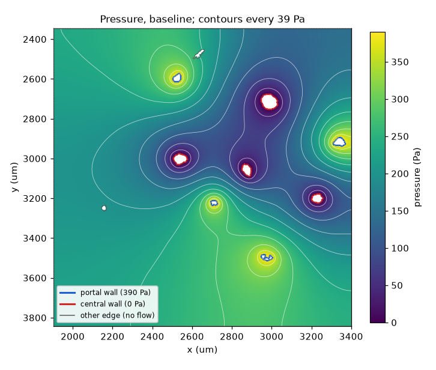
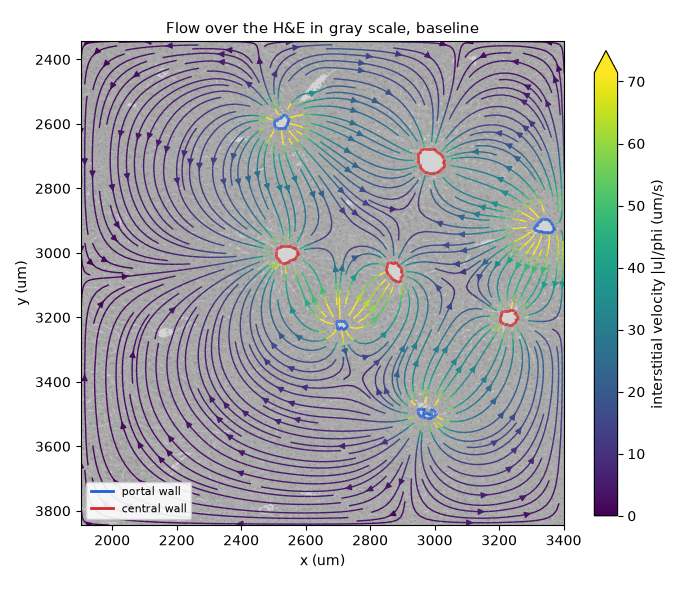
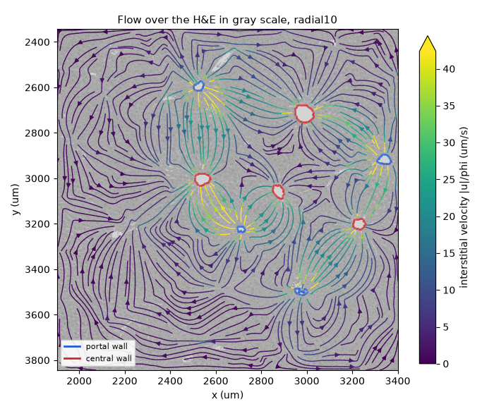

# Milestone 2 end to end on a real slide

Status: 2026-11-25, slidesim `feat/m2-perfusion` at d399cfb, slideviz `feat/scene-export` at
06f9b0f.
Verification item 6 of `docs/superpowers/specs/2026-11-25-slidesim-m2-perfusion-design.md`, with
the parameters of `docs/parameters/m2-perfusion-mouse.md`. Not part of CI: the slides are not in
the repository.

## Summary

- The chain from a slide pair to slidesim runs without manual steps
  (`scripts/e2e/m2_real_slide.sh`, 26 s for the slideviz part, 5-9 min per study on 4 processes).
- The flow checks hold in every run: portal walls inflow, central walls outflow, net flow below
  3e-13 of the wall flow.
- The mean interstitial velocity over the field is 17 um/s for the baseline, a quarter of the 73
  um/s the parameter document expects; calibrated 42 um/s instead of 180 um/s. The model behaves
  as Darcy flow should (velocities scale with k/mu exactly); the difference is the geometry: the
  field has 4 portal and 4 central walls in 2.23 mm^2 of tissue, and the median distance from a
  point to the nearest portal wall plus the nearest central wall is 629 um, not 230 um.
- `advection_defect`, the non-conservation of the primal P1 Darcy velocity, is 7.6 % of the portal
  inflow at 1 s and 3.5 % at 10 s with 2 refinements, 12.2 % and 5.7 % with 1, 18.9 % and 9.1 %
  with none, and 4.6 % at 1 s with 3: it falls with the element size at an order of about 0.65.
  The total mass hardly shows it: it agrees between the levels within 0.9 % (1 s) and 0.3 %
  (10 s), and its growth between 1 and 2 s matches the conservative portal inflow within 0.3 % at
  every level. The numbers are consistent with most of the defect being the error of the normal
  velocity at the walls (the cell gradient gives a portal wall flux 2-13 % below the conservative
  one at 2 refinements). The last section says what this means for milestone 3.

## Slide, field and mesh

| | |
|---|---|
| Slides | `mouse_apap_000mg_m1_he` and `mouse_apap_000mg_m1_cyp2e1` (control animal, no necrosis) |
| Field | 1500 um square, centre at H&E level 0 pixel (row 14000, column 12000); x from 1902 to 3402 um, y from 2344 to 3844 um |
| Tissue | 2.23 mm^2 (the whole field), 10 lumina: 4 portal walls, 4 central walls, 2 unclassified (no condition, no flow) |
| Mesh (slideviz `build_mesh.py`, plain, 5:20 um) | 31237 triangles, 16027 nodes, minimum quality 0.57 |
| Refinements | 0: 31237, 1: 124948, 2: 499792 (the studies), 3: 1999168 triangles; elements 1.25-5 um at 2 refinements |
| Zonation map | 854 x 854 pixels at 1.769 um/px, the direction of the anisotropic permeability |

The outer square of the field (`field_cut`) and the unclassified lumina have no condition: no flow
through them for the pressure, free outflow for the tracer.

## Studies

`testdata/studies/m2_real_slide/`, values of the parameter document: pressure 390 Pa at the
portal walls and 0 Pa at the central walls, porosity 0.15, sucrose with diffusion 700 um^2/s,
1 mM at the portal walls from t = 0, initial 0, `g0` 4.3e-4 1/um; time step 0.05 s to 10 s,
outputs at 0, 1, 2, 3, 5 and 10 s; 2 refinements.

| Study | viscosity (Pa*s) | k_along (um^2) | k_across (um^2) |
|---|---|---|---|
| baseline | 2.4e-3 | 0.0156 | 0.0175 |
| calibrated | 2.4e-3 | 0.038 | 0.043 |
| whole_blood | 3.5e-3 | 0.0156 | 0.0175 |
| radial10 | 2.4e-3 | 0.0156 | 0.00156 |

The time step is converged: the baseline at 0.025 s gives the same total mass (37946 vs 37945
mM*um^2 at 3 s), `advection_defect` (-882.10 vs -882.15 mM*um^2/s) and front area to 4 digits.

## Run times

Optimized build (`deps/install/native-opt`, `cargo build --release`), `mpiexec -n 4` (Open MPI
4.1.6) on a shared 20-core machine.

| Run | triangles | wall time |
|---|---|---|
| slideviz chain (zonation layers to scene) | | 26 s |
| baseline, 0 refinements | 31237 | 5 s |
| baseline, 1 refinement | 124948 | 70 s |
| baseline, 2 refinements | 499792 | 370 s |
| calibrated | 499792 | 557 s |
| whole_blood | 499792 | 310 s |
| radial10 | 499792 | 359 s |
| baseline, 2 refinements, time step 0.025 s, to 3 s | 499792 | 217 s |
| baseline, 3 refinements, to 3 s | 1999168 | 612 s |

## Flow checks

`perfusion.tag_flows` of `summary.json` (um^2/s, positive into the domain):

| Run | portal_wall | central_wall | sum / portal_wall |
|---|---|---|---|
| baseline, 0 refinements | 12626.5 | -12626.5 | -6.4e-14 |
| baseline, 1 refinement | 12588.1 | -12588.1 | 2.1e-13 |
| baseline, 2 refinements | 12575.0 | -12575.0 | 7.2e-14 |
| baseline, 3 refinements | 12570.4 | -12570.4 | 2.7e-14 |
| calibrated | 30689.0 | -30689.0 | 1.3e-13 |
| whole_blood | 8622.8 | -8622.8 | 7.4e-14 |
| radial10 | 6246.1 | -6246.1 | 3.0e-14 |

Every portal flow is positive, every central flow negative, and the sums are zero to rounding
(the check asked for 1e-8). The wall flow changes by 0.4 % from 0 to 3 refinements. The ratios
between the studies are those of k/mu: calibrated / baseline 2.44 (k ratio 2.44), whole_blood /
baseline 0.686 (2.4/3.5 = 0.686).

## Pressure and flow



The pressure falls steeply within about 100 um of each wall and is flat far from the walls: the
median over the tissue is 212 Pa, the 10th and 90th percentiles 102 and 274 Pa (the outer parts
of the field are high, the middle with three central walls close together is low). The y axis
points down, as the rows of the slide.



Streamlines of the Darcy velocity over the H&E of the field (gray scale), colored by the
interstitial velocity |u|/phi. The mesh walls lie on the lumina of the H&E (checked at 1 um/px
around two vessels). Flow leaves each portal wall to all sides and enters each central wall from
all sides; the strongest paths join the closest portal-central pairs (for example the portal wall
at (2710, 3220) um and the central walls at (2880, 3050) and (2540, 3000) um). The corners of the
field, more than 500 um from any wall, carry slow flow along the no-flow outer edge.

With strong radial anisotropy (radial10) the streamlines between near pairs are straighter and
the flow across the zonation gradient, in the corners, is weaker and irregular:



## Interstitial velocity

From `velocity.vtu`: the nodal velocity averaged over each cell, |u|/phi, weighted with the cell
areas over the tissue. "Near pairs" is the tissue whose distance to the nearest portal wall plus
the distance to the nearest central wall is below 300 um (6.6 % of the tissue area); L = 230 um
in the parameter document.

| Study | mean (um/s) | p10 | median | p90 | near pairs: mean (median) | within 20 um of portal / central walls | expected |
|---|---|---|---|---|---|---|---|
| baseline | 17.1 | 2.3 | 9.8 | 40.1 | 57.7 (50.8) | 105 / 80 | 73 (50-100) |
| calibrated | 41.7 | 5.5 | 24.0 | 97.9 | 140.7 (123.9) | 256 / 196 | 180 |
| whole_blood | 11.7 | 1.6 | 6.7 | 27.5 | 39.5 (34.8) | 72 / 55 | 50 |
| radial10 | 8.2 | 0.7 | 3.6 | 22.2 | 29.7 (25.9) | 54 / 41 | (none) |

The mean of the baseline is the same at 0 to 3 refinements (17.10, 17.10, 17.09, 17.09 um/s). An
estimate from the cell pressure gradients with the mean of the two permeabilities gives 17.6
um/s, which confirms the nodal velocity output. Half of the tissue area flows below 10 um/s.

The pressure gradient: mean 0.38 Pa/um over the tissue, against 390 Pa / 230 um = 1.70 Pa/um in
the parameter document; 2.34 Pa/um within 20 um of the portal walls, 1.81 Pa/um within 20 um of
the central walls (1.7 % of the area together) and 0.35 Pa/um elsewhere.


Left: the interstitial velocity falls with the local portal-central distance as Darcy flow
should. The dashed line, a straight one-dimensional path, is an upper bound; for the baseline the
median is within a factor of about 1.3 of it at 200-250 um. radial10 stays a factor of about 3
below it, since its flow has to cross the zonation gradient in places. Right: the distribution
over the tissue is wide and has two modes, one from the tissue between near pairs (20-40 um/s for
the baseline), one from the far corners (3-6 um/s).

Why the field mean is low: the whole slide has 221 lobules on 32.1 mm^2 of tissue, 0.145 mm^2
per lobule, so the 2.23 mm^2 field holds about 15 lobules, and so about 15 central veins. The mesh
has 4 central and 4 portal walls. The vessel walls come from the lumen mask of slideviz, which
keeps lumina of at least 500 um^2 (about 25 um across) that are open in the section; smaller or
collapsed vessels are tissue in the mesh. The median portal-central distance is then 629 um (10th
to 90th percentile 342-1273 um) instead of 230 um, and the flow, which falls with the distance,
is a quarter of the expected mean. Where the vessels are as close as in the parameter document,
the model gives the expected values: 51-58 um/s for the baseline (expected 73, within the 50-100
range of the check) and 124-141 um/s calibrated (expected 180).

## Sucrose front


Sucrose at 1 mM enters at the portal walls. The 0.5 mM line (white) is about 50 um from the
portal walls at 1 s, 100-150 um at 3 s, and reaches the nearest central walls at 10 s. The front
is wider than the portal-central path suggests because the flow leaves each portal wall to all
sides, also into the slow far tissue.

| Time (s) | tissue above 0.5 mM | mean at the central wall nodes (mM) | total mass (mM*um^2) |
|---|---|---|---|
| 1 | 3.5 % | 0.0001 | 13272 |
| 2 | 6.8 % | 0.012 | 25822 |
| 3 | 10.1 % | 0.058 | 37945 |
| 5 | 16.1 % | 0.172 | 59905 |
| 10 | 29.2 % | 0.428 | 102148 |

With 2 refinements the minimum of the field stays above -1e-14 mM and the maximum at 1 mM: no
over- or undershoot at these cell Peclet numbers (Darcy velocity times element size over
diffusion: 0.03-0.1 near the portal walls). The front at 3 refinements agrees with 2 refinements
(10.09 % of the tissue above 0.5 mM at 3 s, 0.0575 against 0.0576 mM at the central walls).


At 3 s the mean at the central wall nodes is 0.058 mM (baseline), 0.284 (calibrated), 0.020
(whole_blood) and 0.008 (radial10).

## Conservation of the primal Darcy velocity

`advection_defect` (mM*um^2/s, from `summary.json`), relative to the advective inflow at the
portal walls, taken as the portal wall flow times 1 mM (`tag_flows.portal_wall`; it is the
conservative flow, from the residual of the pressure equation):

| Baseline | 1 s | 2 s | 3 s | 5 s | 10 s |
|---|---|---|---|---|---|
| 0 refinements (5-20 um) | -2383 (-18.9 %) | -2348 (-18.6 %) | -2211 (-17.5 %) | -1844 (-14.6 %) | -1154 (-9.1 %) |
| 1 refinement (2.5-10 um) | -1531 (-12.2 %) | -1508 (-12.0 %) | -1418 (-11.3 %) | -1177 (-9.4 %) | -722 (-5.7 %) |
| 2 refinements (1.25-5 um) | -954 (-7.6 %) | -940 (-7.5 %) | -882 (-7.0 %) | -728 (-5.8 %) | -435 (-3.5 %) |
| 3 refinements (0.63-2.5 um), to 3 s | -583 (-4.6 %) | -574 (-4.6 %) | -538 (-4.3 %) | | |

| 2 refinements | 1 s | 3 s | 10 s |
|---|---|---|---|
| calibrated | -7.4 % | -4.7 % | -0.6 % |
| whole_blood | -7.6 % | -7.4 % | -4.8 % |
| radial10 | -8.8 % | -8.7 % | -5.9 % |

The defect at 1 s falls by a factor of 1.55 from 0 to 1 refinement, 1.60 from 1 to 2 and 1.64
from 2 to 3 (orders 0.63, 0.68 and 0.71 in the element size). It is largest at early times, when
the sucrose is high only next to the portal walls. On the toy mesh of the tests (`lobule_toy`) it
was 11-20 %.

What the defect does and does not do to the result:

- The total mass agrees between the levels: 13380, 13298, 13272 and 13264 mM*um^2 at 1 s for 0
  to 3 refinements (0.9 % apart, converging: the steps are 82, 26 and 8), 101891, 102004 and
  102148 at 10 s for 0 to 2 (0.3 %). If the defect were mass created in the tissue, 0 and 3
  refinements would differ by about (2383 - 583) mM*um^2/s x 1 s, 14 % of the mass at 1 s.
- Between 1 and 2 s, when almost nothing has reached the central walls yet (mean 0.0001-0.012
  mM there), the mass grows at 12587, 12558, 12550 and 12549 mM*um^2/s for 0 to 3 refinements,
  against a conservative portal inflow of 12626, 12588, 12575 and 12570 mM*um^2/s: the global
  balance closes within 0.3 % with the conservative wall flow.
- The defect compares the transport term in the tissue with the advective flux through the
  boundary computed from the primal velocity at the Gauss points of the wall edges. That wall
  flux is too small: the cell pressure gradient at the portal walls gives a flux 23, 17, 13 and
  10 % below the conservative one with k_along, and 14, 7 and 2 % below and 1 % above with
  k_across, at 0 to 3 refinements (the permeability normal to the wall lies between the two). The
  numbers are consistent with the defect being mostly this error of the normal velocity at the
  walls; they do not exclude local errors in the tissue that cancel in the total.

For milestone 3 this means: the tracer amounts are right to about 1 % already at 0 refinements,
but any flux through an edge computed from the primal velocity (the flux into a central vein, an
outflow balance per vessel, a per-cell uptake balance driven by the velocity) has an error of
several percent at the resolution used here and converges slowly, with order about 0.65. A
velocity with continuous normal flux (flux recovery from the pressure residual, or a mixed
method) would make such fluxes consistent with the conservative wall flows that slidesim already
reports. It is not needed for the concentrations themselves.

## Deviations from the parameter document

1. Mean interstitial velocity: 17 um/s (baseline) instead of 73 um/s, 42 instead of 180
   (calibrated), 12 instead of 50 (whole blood). Cause: the field has 4 portal and 4 central walls
   for about 15 lobules, a median portal-central distance of 629 um instead of 230 um, and a mean
   pressure gradient of 0.38 Pa/um instead of 1.70. Between near pairs the values are 51-58,
   124-141 and 35-40 um/s, close to the expectations.
2. Transit time: the parameter document expects the front to reach the central walls after about
   3 s. Here the mean concentration at the central walls is 0.058 mM at 3 s and 0.43 mM at 10 s
   (baseline); the 0.5 mM line reaches the nearest central walls between 3 and 10 s. The calibrated
   study is closer (0.28 mM at 3 s).
3. The calibration of the parameter document (k_along = 0.038 um^2 for 180 um/s at L = 230 um)
   does not give 180 um/s on this field for the same reason as 1. Calibrating k on this field
   would compensate missing vessels with a higher permeability, which would be wrong.
4. radial10: the maximum pressure is 390.0038 Pa, 1e-5 above the portal value (P1 with a strongly
   anisotropic tensor has no discrete maximum principle). The flow halves (6246 against 12575
   um^2/s), because part of the flow has to cross the zonation gradient.

## Reproduce

```bash
export SLIDEVIZ_DATA=/path/to/APAP_zarr     # slides, sidecars and predictions/; read only
scripts/e2e/m2_real_slide.sh                 # slideviz chain, the four studies, baseline at 1 refinement
BASELINE_REFINEMENTS="0" STUDIES= STEPS=runs scripts/e2e/m2_real_slide.sh   # baseline at 0 refinements
```

The script writes to `OUT` (see its header for the settings), one folder per run with
`summary.json`, `pressure.vtu`, `velocity.vtu` and `sucrose_<i>.vtu`, and stops if a flow check
fails. The 3-refinement and time step checks were run by hand with the baseline study changed by
`jq` (`mesh.refinements = 3, time.end = 3`; `time.dt = 0.025, time.end = 3`).
