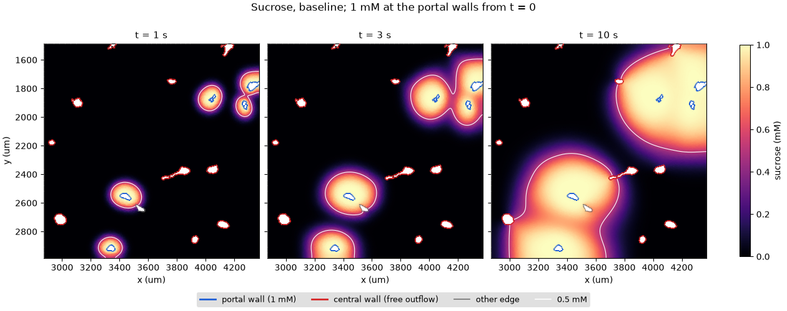

# Results

Each milestone ends with runs on real slides, recorded with every number, table and figure in one
document per run. The pages of this section are those documents: they live in `docs/results/` of
the repository, their figures in a folder of the same name beside them, and the scripts that made
them are named in their "Reproduce" sections. The slides are not in the repository, so these runs
are not part of CI.

- **[M2: perfusion on a real slide](2026-11-m2-real-slide.md)**: the chain from a slide pair to
  slidesim without manual steps, Darcy flow from 5 portal to 13 central wall pieces of a 1500 um
  field, interstitial velocities against the literature, a sucrose front, the mass balance and
  the non-conservation of the primal velocity.
- **[M3: wall classes on dosed slides](2026-11-m3-wall-classes.md)**: whether the portal and
  central classification of the lumina from CYP2E1 holds on the dosed slides, and the scenes with
  the `cyp2e1` and `necrosis` maps.
- **[M3: performance](2026-11-m3-performance.md)**: profiles of the transport and the changes
  that made a step 29 times faster, the setup and output phases, and the coupled 24 h baseline of
  cells and fields on both paths.
- **[M4: meshing real slides](2026-11-m4-meshing.md)**: slidesim's mesher on slideviz's tagged
  polygons of real slides against slideviz's gmsh meshes (passing, after a cap of the size at
  short boundary segments; slideviz retires its gmsh step), and three real fields as example
  scenes.
- **[M4: transport solves](2026-11-m4-performance.md)**: the linear solves of the transport
  with 5.8 times fewer flops on the generated lobule (coarse solve, initial guess, the linear
  tolerance `solver.linear_rtol` of the studies), measured on small problems.
- **[Cells on dosed slides (deferred)](m3-dosed-slides.md)**: the SPT cell model for 24 h on
  dosed slides, the simulated necrosis against the measured one; deferred to later, larger
  hardware, not part of milestone 3.

The [perfusion parameters](../parameters/m2-perfusion-mouse.md) of the mouse liver lobule, from
the literature, are the parameters of these runs.

<figure markdown="span">
  
  <figcaption>Sucrose entering a real field at the portal walls, at 1, 3 and 10 s (milestone 2).</figcaption>
</figure>
